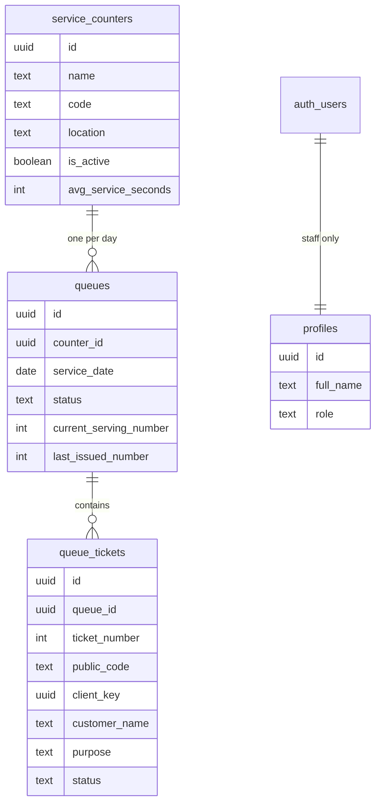

# Numera

Digital queue tickets and waiting-time estimates for a registrar's office. A student takes a number, leaves the window, and watches their place in line. Staff call the next number, mark it served, and review the day's record.

## Features

- Get a queue ticket with a unique number and a private code.
- See the number being served, how many people are ahead, and an estimated wait.
- Staff call the next number, mark it served, skip it, or cancel it.
- Pause or close intake without losing the people already waiting.
- Store finished tickets and show daily counts.
- Add, edit, deactivate, or delete service counters.

## Stack

- Next.js App Router for pages, server actions, and route handlers.
- Supabase for Postgres, Auth, and the API. The local stack runs in Docker through the Supabase CLI.
- Zod checks input in the Next.js server before it reaches Postgres. Postgres checks it again.

## Project structure

```text
src/app/(public)          Customer home and ticket page
src/app/board             Hallway display
src/app/staff             Sign-in, desk, history, counters
src/app/api               Short JSON reads for live updates
src/server/actions.ts     Mutations: issue, cancel, call next, save counter
src/server/queries.ts     Reads used by pages and route handlers
src/server/rpc.ts         Calls a Postgres function and checks the shape
src/components            Ticket, board, and staff interface
supabase/migrations       Tables, rules, and access control
supabase/seed.sql         Demo counters and tickets
supabase/config.toml      Local Supabase / Docker settings
scripts/seed-staff.mjs    Creates the local staff login
scripts/verify.mjs        Checks validation, security, and the staff flow
```

A customer page loads data in a Server Component. The browser then polls a route handler every few seconds. A button calls a server action. The action validates the input and calls a Postgres function. The function locks the queue row, applies the rule, and returns JSON. The page shows that result. Waiting time is calculated in Postgres, not in the browser.

## Setup

You need Node.js 22, npm, and Docker Desktop.

1. Start Docker Desktop and wait until it is running.
2. Install dependencies:

```bash
npm install
```

3. Start the local Supabase stack. The first run downloads Docker images and can take several minutes.

```bash
npm run db:start
```

4. Copy the local keys into `.env.local`. Get them with:

```bash
npx supabase status -o env
```

`.env.local` should look like `.env.example`:

```text
NEXT_PUBLIC_SUPABASE_URL=http://127.0.0.1:54321
NEXT_PUBLIC_SUPABASE_ANON_KEY=<ANON_KEY from supabase status>
SUPABASE_SERVICE_ROLE_KEY=<SERVICE_ROLE_KEY from supabase status>
```

The Next.js app uses only the URL and the anon key. The service-role key is used by `npm run seed:staff` and must stay out of the browser, slides, and screenshots.

5. Create the staff login:

```bash
npm run seed:staff
```

6. Start the site:

```bash
npm run dev
```

Open [http://localhost:3000](http://localhost:3000).

`npx supabase status` also prints the Studio URL. Studio is the database UI for the defense. `docker ps` shows the containers, named with the project id `numera` (database, API gateway, Auth, REST, and Studio).

In `supabase/config.toml`, `[auth].enable_signup` is false so visitors cannot register. `[auth.email].enable_signup` stays true because this CLI uses that flag to turn the email provider on. If it is false, the seeded staff account cannot sign in.

Stop the stack with `npm run db:stop`. Reset demo data with `npm run db:reset` and then `npm run seed:staff`.

## Local staff login

This account exists only in the local Docker database. Public signup is disabled in `supabase/config.toml`.

| Email | Password |
| --- | --- |
| staff@campus.edu | NumeraStaff#2026 |

Do not show the password or any API key on a slide or a screenshot.

## Demo script

Seeded state for today:

- Registrar Window 1 is serving **005**. Tickets 006, 007, and 008 are waiting.
- Registrar Window 2 is open and empty. The first ticket there is **001**.
- ID and Clearance has no queue until someone takes a ticket.
- Yesterday's Window 1 queue is closed and shows up in History.

Suggested walkthrough:

1. On the home page, take a ticket at Window 1. The number should be **009**, with four people ahead.
2. Leave the ticket page open. It refreshes on its own.
3. Try to take another Window 1 ticket in the same browser. Numera opens the existing ticket instead.
4. Sign in at `/staff`. Mark 005 served, then call next. The board should move to **006**.
5. Open `/board` for the hallway view.
6. Open History and switch the date to yesterday.
7. Add a counter, confirm it appears for customers, then deactivate or delete it. Seeded counters cannot be deleted because they already have queues.

`npm run verify` runs the same rules from the command line. It changes live tickets. Run `npm run db:reset` and `npm run seed:staff` afterward if you want the demo numbers above.

## Waiting time

For a waiting ticket:

```text
people ahead = tickets currently called
             + waiting tickets with a lower number
estimate     = people ahead × average service time
```

The average is the mean of today's completed visits at that counter when at least three exist. Otherwise it uses the counter's usual service time (3 minutes on the registrar windows, 4 minutes at ID and Clearance). A called ticket tells the person to go to the window. Served, skipped, and cancelled tickets do not get an estimate.

The sentence under the estimate on the ticket page says which of those two averages was used.

## Database



`queues.service_date` uses Asia/Manila, so "today" matches the campus day rather than UTC.

Ticket status is `waiting`, `called`, `served`, `skipped`, or `cancelled`. Cancelling is the delete action. The row stays so the daily counts remain honest. A counter that already has a queue cannot be hard-deleted; staff deactivate it instead.

Active-ticket rules, enforced by unique indexes and the `issue_ticket` function:

- One waiting or called ticket per browser per queue.
- One waiting or called ticket per name per queue, when a name was entered.
- Ticket numbers are unique inside a queue and are not reused.
- A new ticket is refused when the counter is inactive or the queue is paused or closed.

## Access control

| Who | Can do |
| --- | --- |
| Anonymous visitor | List counters, read the board, issue a ticket, read one ticket by its code, cancel that ticket from the same browser |
| Signed-in staff | Everything above, plus call next, serve, skip, cancel any active ticket, change intake, manage counters, read history and names |
| Service role | Used only by `scripts/seed-staff.mjs` on your machine |

Row Level Security is on for every table. The anon and authenticated API roles have no table grants on tickets, queues, or counters, so a direct REST read does not return customer names. Customers reach data only through `security definer` functions. Staff functions call `is_staff()`, which is true only when `auth.uid()` has a row in `profiles`.

The public board returns numbers, not names. The ticket page returns the name only for the code the visitor was given.

## Scripts

| Command | What it does |
| --- | --- |
| `npm run dev` | Next.js |
| `npm run db:start` | Start Supabase in Docker |
| `npm run db:stop` | Stop the containers |
| `npm run db:reset` | Reapply the migration and demo tickets |
| `npm run seed:staff` | Create or update the local staff user |
| `npm run verify` | Run the queue checks |
| `npm run lint` | ESLint |
